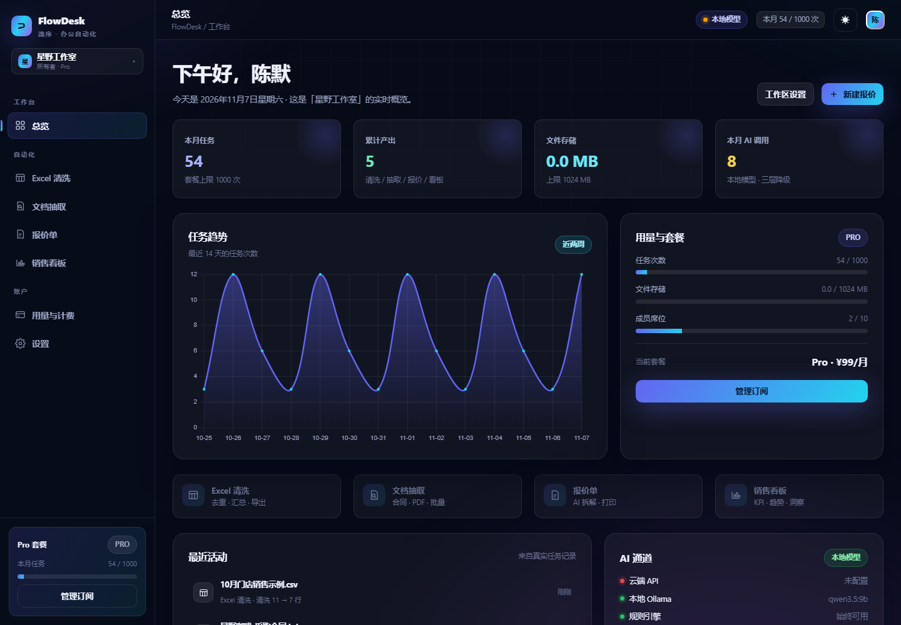
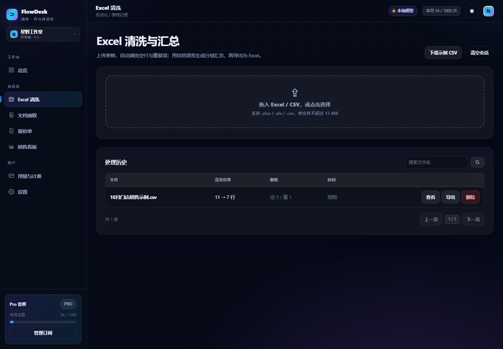
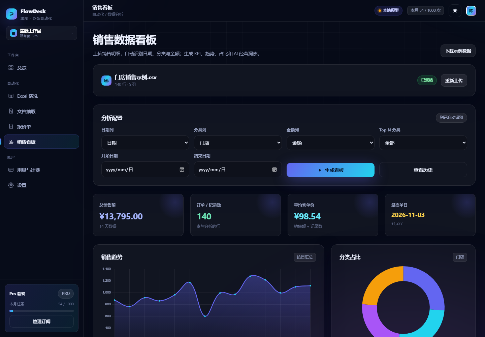

# FlowDesk 流序 · AI 办公自动化工具集

**把表格、文档、报价和销售数据中的重复工作整理成工具。**

这个仓库包含一套中文作品展示网站、多个可独立体验的办公工具，以及进一步整合后的 FlowDesk SaaS 工作台。项目从具体业务任务出发，连接文件输入、数据处理、AI 辅助、结果导出和任务记录。

技术主体为 HTML/CSS/JavaScript 与 Python/FastAPI。既有浏览器端工具，也有独立后端和带账号、工作区、权限及用量管理的应用。

## 界面预览



<p>
  
  
</p>

以上为仓库留存截图，更多页面见 [saas/docs/screenshots](saas/docs/screenshots/)。

## 项目组成

### 展示网站与独立工具

根目录网站以中文和英文页面展示办公自动化方向。`projects/` 中包含 Excel 自动化、销售看板、报价生成、文档字段提取和产品落地页等独立页面。

浏览器端共用 `assets/` 中的数据处理和界面能力，部分工具可调用 `excel-backend/` 的 FastAPI 服务及本地 Ollama。

### FlowDesk 工作台

`saas/` 将多个业务模块收进统一工作区：

- **Excel 清洗**：上传表格、删除空行与重复行、分组聚合、导出处理结果。
- **文档字段抽取**：文本与文件输入、自定义字段、单次处理与批量任务队列。
- **报价单**：条目、数量、税率、折扣和币种处理，支持状态流转与打印。
- **销售看板**：列识别、KPI、趋势、分类统计与 AI 洞察。
- **团队与权限**：账号、工作区成员与 owner/admin/member 角色。
- **用量与审计**：配额、任务记录、操作记录和平台管理。

计费模块为沙箱，实现套餐与配额变化的演示流程，不接真实支付。

## AI 怎样参与

FlowDesk 将模型调用放在业务处理链路的一部分：可以调用 OpenAI 兼容接口、使用本地 Ollama，也可回退到确定性规则。

结果记录使用的通道，避免把规则输出描述成真实模型推理。Excel 的自然语言计划、报价条目和经营洞察由业务模块继续校验或呈现，核心文件处理不依赖模型永远在线。

## 架构与实现

- **模块化单体**：FlowDesk 以一个 FastAPI 进程组织业务路由、账号、权限、计量和审计。
- **工作区边界**：业务数据通过工作区关联，成员角色参与访问控制。
- **后台文档队列**：任务状态落入 SQLite，由进程内 worker 执行，支持查看、重试和取消。
- **服务端金额计算**：报价金额由后端计算，不只信任浏览器提交的汇总值。
- **本地静态资源**：图表与办公处理相关的前端资源随工程提供。
- **轻量存储**：SQLite WAL 配合本地上传目录，面向小团队和单进程部署。

## 运行展示网站

从仓库根目录执行：

```sh
python -m http.server 8080
```

打开 http://localhost:8080 。涉及后端的独立工具需另行启动：

```sh
pip install -r excel-backend/requirements.txt
python -m uvicorn main:app --app-dir excel-backend --port 8000
```

## 运行 FlowDesk

进入 `saas/`，创建并激活 Python 虚拟环境，然后执行：

```sh
pip install -r requirements.txt
python -m uvicorn app.main:app --host 127.0.0.1 --port 8000 --workers 1
```

访问 http://127.0.0.1:8000 。首次运行根据代码配置创建演示库；本仓库不包含现有运行数据库或真实上传文件。

单进程是当前实现的约束：部分上传会话与 worker 保存在进程内。独立后端和 FlowDesk 都默认使用 8000，体验时选择其一或自行调整端口。

详细模块说明、演示账号、环境变量与部署文件见 [FlowDesk 文档](saas/README.md)；文档中的本地演示密码仅适用于演示环境。

## 检查

```sh
npm ci
npm run test:core
```

根目录还提供浏览器 UI 测试，需要可用浏览器及相应配置。FlowDesk 后端测试可在安装 pytest 后执行：

```sh
cd saas
python -m pytest tests
```

## 源码导航

```text
index.html / en/   中英文展示网站
projects/          独立工具页面
assets/            公共逻辑、样式与第三方资源
excel-backend/     独立办公工具后端
saas/app/          FlowDesk API、权限、业务与任务处理
saas/static/       FlowDesk 前端
saas/samples/      演示输入文件
saas/tests/        工作台后端检查
tests/             独立工具检查
```

## 范围与依赖

当前仓库展示不同阶段的工程，独立页面与 FlowDesk 的能力并不完全相同。第三方浏览器库、OCR 运行资源与语言数据位于 `assets/vendor/`，按各自上游许可使用，不作为项目自研算法展示。

源码上传与本地运行核对不等于线上部署或商用验收；真实数据、密钥、缓存及运行数据库未纳入仓库。
