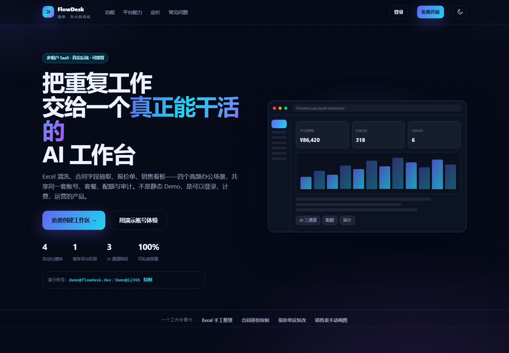
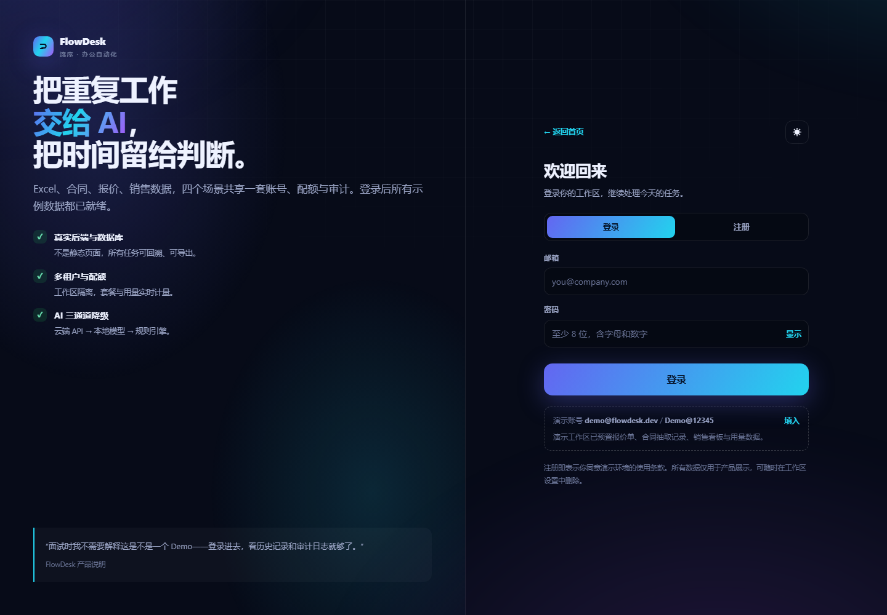
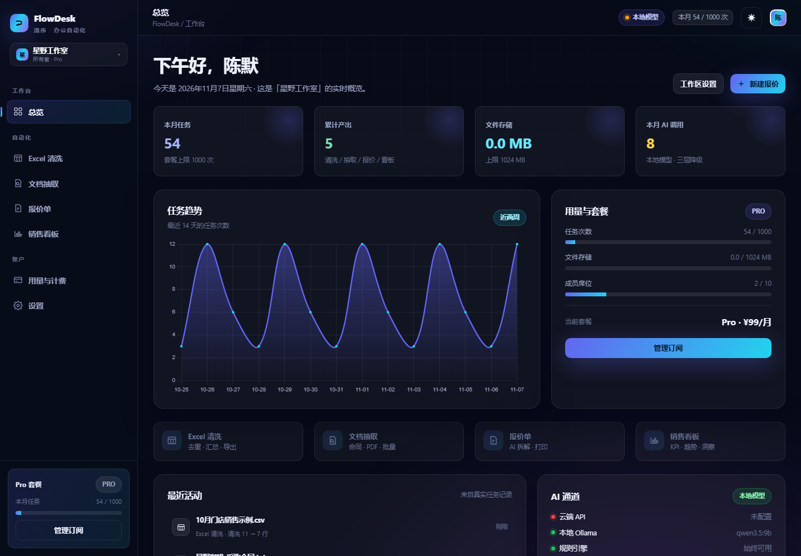
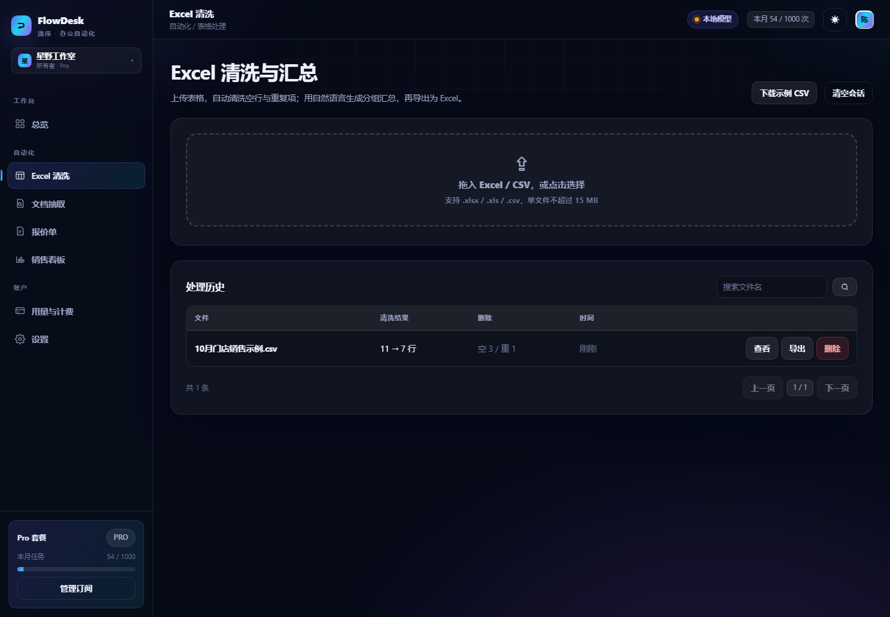
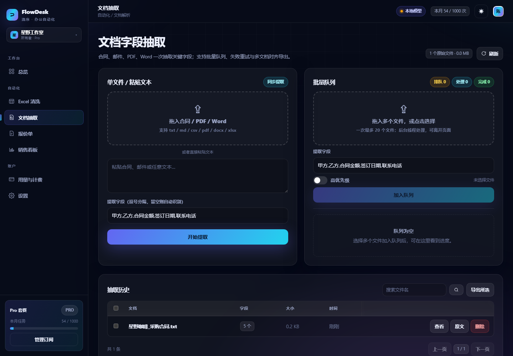
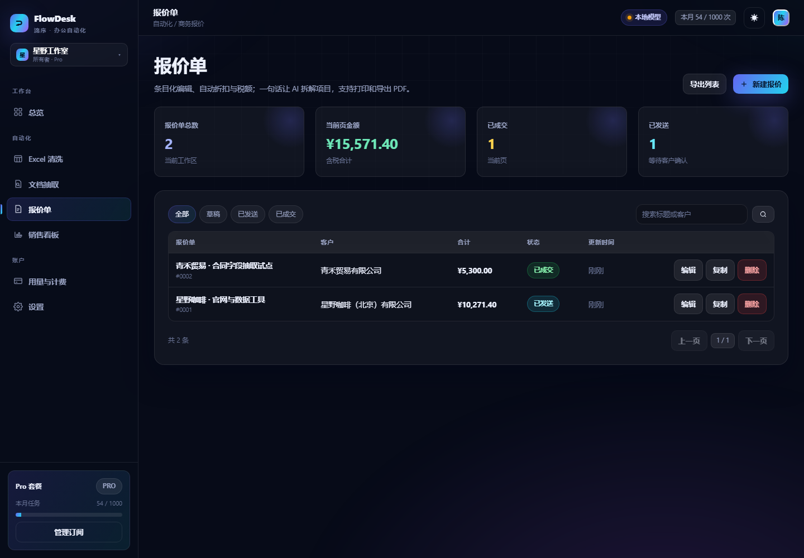
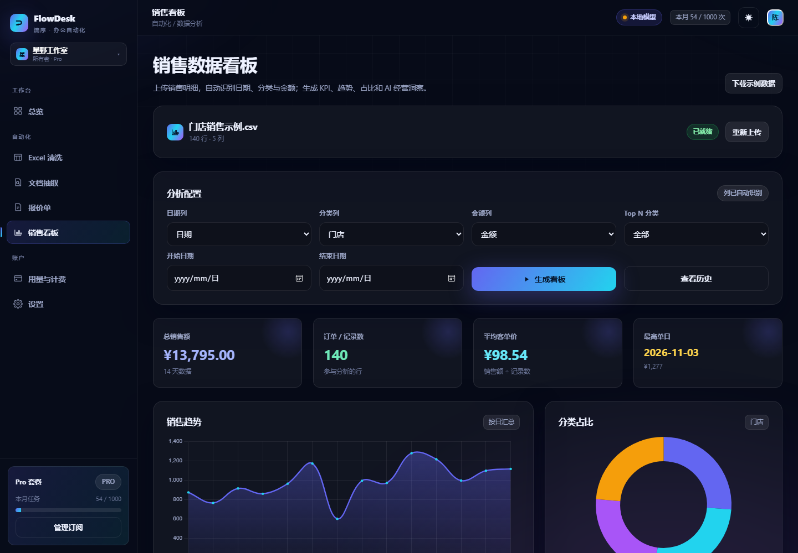
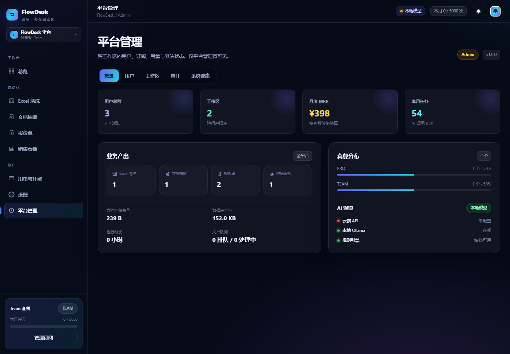
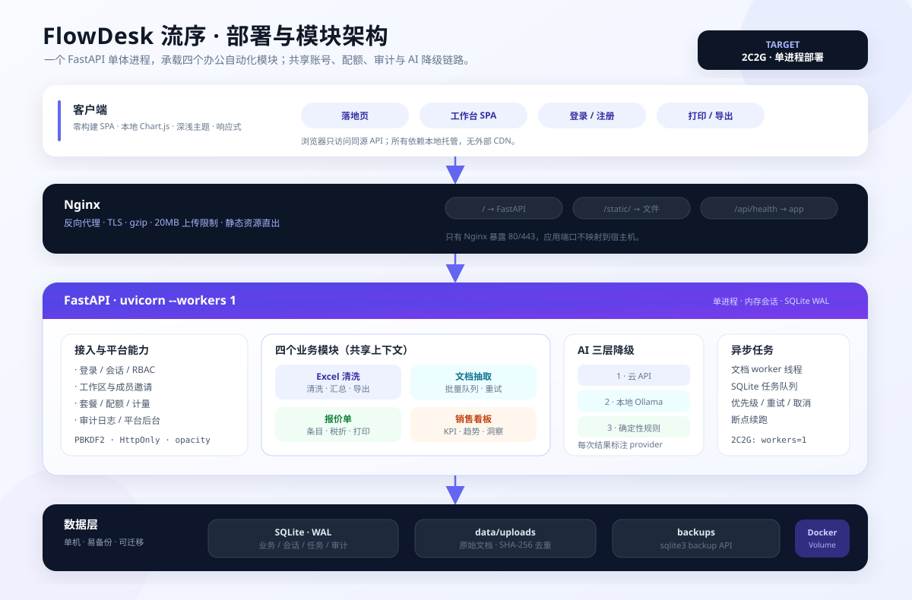

# FlowDesk 流序

> AI 办公自动化工作台 —— 把 Excel 清洗、文档字段抽取、报价单和销售看板收进一个可部署、可计量、可审计的多租户 SaaS。

FlowDesk 不是四个孤立 Demo 的集合，而是一个**模块化单体**：一个 FastAPI 进程、一套账号与权限、一套配额与计费、一套审计与 AI 降级链路，四个业务模块共享同一个工作区。它面向真实小团队，也面向 2 核 2G 云服务器的成本约束。

> 面试准备：先读 [`docs/QUICK-INTERVIEW.md`](docs/QUICK-INTERVIEW.md)（30 分钟速览：技术栈、代码地图、3 分钟口述稿、高频 10 问）。

---

## 目录

- [面试速览](docs/QUICK-INTERVIEW.md)
- [界面预览](#界面预览)
- [在线演示入口](#在线演示入口)
- [功能矩阵](#功能矩阵)
- [技术架构](#技术架构)
- [本地启动](#本地启动)
- [演示账号](#演示账号)
- [业务模块](#业务模块)
- [AI 三层降级](#ai-三层降级)
- [多租户、配额与计费](#多租户配额与计费)
- [Docker 部署（2C2G 方案）](#docker-部署2c2g-方案)
- [环境变量](#环境变量)
- [数据、备份与恢复](#数据备份与恢复)
- [测试](#测试)
- [API 一览](#api-一览)
- [项目结构](#项目结构)
- [设计取舍](#设计取舍)
- [安全清单](#安全清单)
- [延伸阅读](#延伸阅读)
- [Roadmap](#roadmap)

---

## 界面预览

### 落地页



### 登录页



### 工作台总览



### Excel 清洗



### 文档字段抽取



### 报价单



### 销售看板



### 平台管理



---

## 在线演示入口

本地启动后打开：

| 页面 | 地址 |
| --- | --- |
| 产品落地页 | `http://127.0.0.1:8000/` |
| 登录 / 注册 | `http://127.0.0.1:8000/login` |
| 工作台 | `http://127.0.0.1:8000/app#/dashboard` |

建议按 [`docs/DEMO.md`](docs/DEMO.md) 的 5 分钟演示脚本走一遍。仓库内的 `samples/` 提供了可直接上传的 CSV 与合同文本。

---

## 功能矩阵

| 模块 | 能力 | 平台化细节 |
| --- | --- | --- |
| **Excel 清洗** | CSV / XLSX / XLS 上传；空行、重复行清洗；按维度分组求和/计数/均值；自然语言生成汇总指令；结果导出；历史任务 | 上传会话 TTL 2h；大数据集截断保护；任务计量 |
| **文档字段抽取** | TXT / MD / CSV / PDF / DOCX；粘贴文本；自定义字段；单文件即时抽取；批量队列；优先级、重试、取消、失败原因；横向表格导出 | SQLite 任务表 + 单 worker 线程；原始文件去重存储；批量配额预检 |
| **报价单** | 多条目、数量、单价、税率、折扣、多币种；实时合计；打印样式；状态流转；AI 根据需求生成条目 | 工作区隔离；服务端重算金额；审计留痕 |
| **销售看板** | 上传销售数据；自动识别日期/分类/金额；KPI、趋势、分类占比；AI 经营洞察；XLSX / CSV 导出；历史分析 | 最多 2 万行；数据集持久化；AI 结果标注来源 |
| **工作台** | KPI、最近活动、近 14 天用量曲线、AI 通道状态、套餐用量 | 单页应用，无构建步骤 |
| **团队与权限** | 工作区、成员、owner / admin / member；邀请链接；工作区切换 | 会话绑定当前工作区，切换即换上下文 |
| **计费（沙箱）** | Free / Pro / Team；月付/年付；订阅、取消、发票记录 | 明确标注 sandbox，不接真实支付 |
| **审计与后台** | 登录、任务、报价、计费、成员变更审计；平台管理员查看用户/工作区/DB/worker/AI 健康 | 平台管理员与租户管理员分离 |

---

## 技术架构



<details>
<summary>纯文本架构图（无 SVG 环境）</summary>

```text
Browser
  │  HTML / CSS / JS / 本地 Chart.js
  ▼
Nginx  ── TLS / gzip / static / 20MB limit
  │
  ▼
FastAPI（1 个 uvicorn 进程）
  ├─ auth / session / RBAC / workspace
  ├─ Excel / Docs / Quotes / Sales
  ├─ quota / billing / audit
  ├─ AI router：云 API → Ollama → 规则
  └─ doc worker thread
  │
  ▼
SQLite WAL + data/uploads + data/backups
```

</details>

**为什么是单体？** 2C2G 上启动 7–15 个独立服务会先把内存吃光，再带来网关、鉴权、数据库、日志的重复建设。FlowDesk 把“模块边界”放在代码层，把“部署边界”收成一个进程；将来需要拆分时，路由与服务已经按模块隔离，可平滑迁移到 PostgreSQL + Redis + 独立 worker。

更细的模块分层、数据模型与关键链路见 [`docs/ARCHITECTURE.md`](docs/ARCHITECTURE.md)。

**关键约束：**

- `uvicorn --workers 1`：Excel 上传会话保存在进程内；文档 worker 也是进程内线程。
- SQLite 开启 WAL，读写并发更适合“小团队 + 低频任务”的场景。
- 前端零构建、零 CDN，所有资源本地托管；适合内网、弱网和低成本部署。

---

## 本地启动

要求：Python 3.11+（推荐 3.12）。

```bash
cd saas
python -m venv .venv

# Windows
.venv\Scripts\activate
# macOS / Linux
source .venv/bin/activate

pip install -r requirements.txt
python -m uvicorn app.main:app --host 127.0.0.1 --port 8000 --workers 1
```

Windows 也可以直接运行：

```powershell
powershell -ExecutionPolicy Bypass -File scripts/run.ps1
```

首次启动会自动建表并写入演示数据，数据库默认在 `data/flowdesk.db`。

> 本地启动不会自动读取 `.env`；需要自定义配置时，在 PowerShell 中 `$env:ADMIN_PASSWORD="..."`，或使用 Docker Compose（原生支持 `env_file`）。

---

## 演示账号

| 角色 | 邮箱 | 密码 | 说明 |
| --- | --- | --- | --- |
| 演示账号 / 工作区 owner | `demo@flowdesk.dev` | `Demo@12345` | 已带报价、Excel、文档、销售看板与用量数据 |
| 平台管理员 | `admin@flowdesk.dev` | `Admin@12345` | 可进入“平台管理”查看全局用户、工作区、审计与健康 |
| 团队成员 | `member@flowdesk.dev` | `Member@12345` | 演示 member 权限 |

> 这三个密码只用于本地演示。部署后请立刻修改 `ADMIN_PASSWORD`，并视情况设置 `SEED_DEMO=0`。

---

## 业务模块

### 1. Excel 清洗

1. 上传 CSV / XLSX / XLS。
2. 自动识别列类型，给出“日期 / 门店 / 金额”等建议。
3. 勾选去除空行、重复行；选择分组列、数值列与聚合方式。
4. 用自然语言输入“按门店汇总金额”，AI 返回结构化计划，规则引擎兜底。
5. 导出带“清洗结果 + 汇总”两个 sheet 的 XLSX。
6. 历史任务可回看统计与结果。

### 2. 文档字段抽取

- 单文件：上传 PDF / DOCX / TXT / MD / CSV，或直接粘贴文本；指定字段后即时抽取。
- 批量：多文件入队，后台 worker 逐条处理；支持优先级、进度、失败原因、重试、取消。
- 导出：一行一个文档、一列一个字段，直接给业务方。
- 去重：同一工作区相同内容的文件只存一份。

### 3. 报价单

- 条目化报价，支持数量、单位、单价、税率、折扣、CNY/USD/EUR。
- 金额由服务端重新计算，避免前端篡改。
- 支持草稿 / 已发送 / 已接受 / 已拒绝状态。
- AI 根据一句话需求生成 2–5 条报价条目，人工可继续改。
- 专用打印样式，浏览器直接打印或导出 PDF。

### 4. 销售看板

- 上传 CSV / XLSX，自动建议日期、分类、金额列。
- KPI：总销售额、订单数、客单价、最高单日、分类数。
- 趋势折线图 + 分类占比图（本地 Chart.js）。
- AI 经营洞察：3–5 条可执行建议，失败时规则引擎生成确定性结论。
- 历史分析可回看、导出、删除。

---

## AI 三层降级

```text
AI_MODE=auto（默认）
   │
   ├─ 1. OpenAI 兼容云 API（AI_API_KEY 存在时）
   │      DeepSeek / OpenAI / Moonshot / 其他兼容网关
   │
   ├─ 2. 本地 Ollama（检测到在线且已安装对话模型）
   │      自动选择已安装模型；2C2G 不建议部署
   │
   └─ 3. 确定性规则引擎
          永远可用，结果可解释；所有 AI 结果都会标注 via / via_label
```

支持 `AI_MODE=api | ollama | rules | auto`。业务代码只调用 `ai.py` 的业务函数，不直接依赖某一家模型；失败不会阻塞主流程。

前端顶部会显示当前 AI 通道（云端 AI / 本地模型 / 规则引擎），每条 AI 结果也会带来源标签。审计与 `ai_logs` 记录 provider 与耗时，方便回答“这次到底是不是模型算的”。

---

## 多租户、配额与计费

- **用户**：全局账号，可加入多个工作区。
- **工作区**：数据隔离边界；所有业务表都带 `workspace_id`。
- **成员**：`owner / admin / member`；邀请链接绑定邮箱，7 天过期。
- **会话**：opaque token 存数据库，HttpOnly Cookie `fd_session`；服务重启不掉登录。
- **套餐**：Free 50 次/月、20MB、3 人；Pro 1000 次/月、1GB、10 人；Team 5000 次/月、10GB、50 人。
- **计量**：上传、清洗、抽取、分析、洞察都写入 `usage_events`；配额不足返回明确错误。
- **计费**：`POST /api/billing/subscribe` 生成发票并切换套餐；**沙箱模式，不接真实支付**，但完整走通“选套餐 → 生成发票 → 配额变化 → 取消”的闭环。

---

## Docker 部署（2C2G 方案）

### 目录准备

```bash
cd saas
cp .env.example .env
# 编辑 .env：ADMIN_PASSWORD、APP_URL、AI_API_KEY、ENV=production
sudo bash scripts/deploy.sh
```

`deploy.sh` 会：

1. 检查 Docker / Compose；
2. 创建 `data/uploads` 与 `data/backups`；
3. 构建镜像并以单进程启动；
4. 等待 `/api/health` 通过；
5. 输出访问地址与服务状态。

### 组成

| 服务 | 作用 | 资源限制 |
| --- | --- | --- |
| `app` | FastAPI + worker（1 进程） | 1.5 GB / 1.8 CPU |
| `nginx` | 反向代理、静态资源、gzip | 128 MB |

只有 Nginx 暴露端口；应用 8000 只在 Compose 内部网络可见。SQLite 与上传文件落在宿主机 `./data`，容器重建不丢数据。

### 2C2G 调优建议

```bash
# 2G 内存建议加 2G swap
sudo fallocate -l 2G /swapfile
sudo chmod 600 /swapfile
sudo mkswap /swapfile
sudo swapon /swapfile
echo '/swapfile none swap sw 0 0' | sudo tee -a /etc/fstab
```

- 保持 `DOC_WORKERS=1`、`uvicorn --workers 1`。
- `AI_MODE=rules` 最省资源；要真实 AI 时优先 `AI_MODE=auto` + 云 API，**不要**在 2C2G 上跑 Ollama。
- Nginx 直接返回 `/static/`，Python 只处理 HTML 与 API。
- SQLite WAL 足够支撑小团队；需要更高并发时再迁移 PostgreSQL。

### HTTPS

推荐在 FlowDesk 前加一层 Caddy / Cloudflare，或者把 Nginx 80 改为 443 并配置证书。启用 HTTPS 后：

```env
APP_URL=https://your-domain.com
COOKIE_SECURE=1
```

> 域名已经在 Cloudflare？用 **Cloudflare Tunnel** 可以不开公网 80/443、不需要公网 IP，详见 [`docs/DEPLOY-CLOUDFLARE.md`](docs/DEPLOY-CLOUDFLARE.md)。

### 常用命令

```bash
docker compose ps
docker compose logs -f app
docker compose restart app
docker compose down
```

---

## 环境变量

| 变量 | 默认值 | 说明 |
| --- | --- | --- |
| `ENV` | `development` | `production` 时关闭 API 文档 |
| `APP_URL` | `http://localhost:8000` | 对外地址，用于同源校验 |
| `HTTP_PORT` | `80` | Nginx 宿主机端口 |
| `DATA_DIR` | `./data` | 数据目录 |
| `DATABASE_PATH` | `data/flowdesk.db` | SQLite 路径 |
| `ADMIN_EMAIL` / `ADMIN_PASSWORD` | 见演示账号 | 首次启动创建，已有库不覆盖 |
| `SEED_DEMO` | `1` | 是否写入演示数据 |
| `SESSION_DAYS` | `7` | 会话有效期 |
| `COOKIE_SECURE` | `0` | HTTPS 下设为 `1` |
| `MAX_UPLOAD_MB` | `15` | 单文件上限 |
| `MAX_DOC_FILES` | `20` | 单次批量文件数 |
| `DOC_WORKERS` | `1` | 文档 worker 线程数 |
| `AI_MODE` | `auto` | `auto/api/ollama/rules` |
| `AI_BASE_URL` | `https://api.deepseek.com/v1` | OpenAI 兼容地址 |
| `AI_API_KEY` | 空 | 云 API Key |
| `AI_MODEL` | `deepseek-chat` | 云端模型名 |
| `OLLAMA_BASE` | `http://localhost:11434` | 本地 Ollama 地址 |
| `OLLAMA_MODEL` | `qwen2.5` | 本地模型；未安装时自动选择可用模型 |
| `AI_TIMEOUT` | `45` | 单次 AI 超时（秒） |
| `ALLOWED_ORIGINS` | 空 | 额外允许的跨站来源，逗号分隔 |

---

## 数据、备份与恢复

```bash
# 在线备份（SQLite backup API，避免 WAL 半写）
bash scripts/backup.sh
# 生成：data/backups/flowdesk-YYYYmmdd-HHMMSS.db

# 建议每天凌晨 3 点备份，保留 14 天
0 3 * * * cd /opt/flowdesk && bash scripts/backup.sh >> /var/log/flowdesk-backup.log 2>&1
```

恢复：

```bash
docker compose down
cp data/backups/flowdesk-20261107-030000.db data/flowdesk.db
rm -f data/flowdesk.db-wal data/flowdesk.db-shm
docker compose up -d
```

重置演示数据：

```bash
bash scripts/reset_demo.sh   # 会二次确认，并清空上传文件
```

---

## 测试

```bash
pip install -r requirements-dev.txt
pytest -q
```

当前覆盖 **10 个测试用例**：

- 公开页面与健康检查
- 未登录拦截、错误密码、登录与工作区上下文
- Dashboard 结构
- Excel 上传 → 清洗 → 分组 → 导出 → AI 指令 → 历史
- 文档抽取 → 批量入队 → worker 完成 → 导出
- 报价创建 → 修改 → 查询 → AI 生成 → 删除
- 销售数据上传 → 分析 → 洞察 → XLSX/CSV 导出
- 套餐订阅 → 发票 → 取消
- 注册新租户后的数据隔离
- 平台管理概览、用户、工作区、审计、健康；普通用户 403

测试使用临时数据库、`AI_MODE=rules`，不触碰 `data/flowdesk.db`，也不依赖网络。

---

## API 一览

所有业务 API 以 `/api` 开头；生产环境关闭 `/api/_docs`。

| 前缀 | 主要能力 |
| --- | --- |
| `/api/auth` | 注册、登录、登出、当前用户、切换工作区、改资料/密码 |
| `/api/workspace` | 工作区信息、成员、邀请、接受邀请、改名 |
| `/api/dashboard` | KPI、最近活动、用量曲线、AI 状态 |
| `/api/excel` | 上传、清洗、AI 指令、导出、历史、AI 报告 |
| `/api/docs` | 即时抽取、批量入队、任务列表/重试/取消、历史、导出 |
| `/api/quotes` | 列表、详情、创建、修改、删除、AI 生成条目 |
| `/api/analytics` | 数据集上传、分析、洞察、历史、导出、删除 |
| `/api/billing` | 套餐、用量摘要、发票、订阅、取消 |
| `/api/admin` | 平台概览、用户、工作区、审计、健康（仅平台管理员） |

认证同时支持 HttpOnly Cookie 与 `Authorization: Bearer <token>`，方便脚本和后续开放 API。

---

## 项目结构

```text
saas/
├─ app/
│  ├─ main.py             # FastAPI 入口、安全头、静态页、生命周期
│  ├─ config.py           # 环境变量配置
│  ├─ database.py         # SQLite schema / 连接 / 查询 / JSON 工具
│  ├─ security.py         # PBKDF2、会话、Auth 依赖、角色守卫
│  ├─ quota.py            # 套餐、计量、配额、存储与成员限制
│  ├─ audit.py            # 审计日志
│  ├─ ai.py               # 云 API / Ollama / 规则三层降级
│  ├─ seed.py             # 管理员、演示工作区、示例数据
│  ├─ workers.py          # 文档任务队列与文件存储
│  ├─ routers/            # auth/workspace/dashboard/excel/docs/quotes/analytics/billing/admin
│  └─ services/           # excel/docs/quotes/analytics 业务逻辑
├─ static/
│  ├─ index.html          # 落地页
│  ├─ login.html          # 登录 / 注册
│  ├─ app.html            # 工作台外壳
│  ├─ style.css           # 设计系统（深浅主题、响应式、打印）
│  ├─ assets/             # landing.js / auth.js / common.js / app.js
│  └─ vendor/             # 本地 Chart.js
├─ tests/                 # pytest API 回归
├─ samples/               # 演示上传文件
├─ docs/                  # 演示脚本 + 架构图
├─ scripts/               # deploy / backup / reset_demo / run.ps1
├─ Dockerfile
├─ docker-compose.yml
├─ nginx.conf
├─ requirements.txt
├─ requirements-dev.txt
└─ .env.example
```

---

## 设计取舍

1. **模块化单体而不是微服务**：2C2G 上先保证“能跑、好维护、可演示”。模块边界通过 `routers/` 与 `services/` 隔离，未来可按模块拆出。
2. **SQLite 而不是 PostgreSQL**：单机、低并发、备份简单；WAL 解决读写互斥的主要痛点。迁移路径是替换 `database.py` 与 SQL 方言，业务层不感知。
3. **数据库会话而不是 JWT**：服务重启不掉登录，登出/禁用可立即失效；opaque token 不携带敏感信息。
4. **异步任务用 SQLite 队列而不是 Celery/Redis**：少一个中间件、少一份内存；任务可重试、可取消、可断点续跑。代价是 worker 与 web 同进程，需要单进程部署。
5. **AI 必须可降级**：规则引擎不是“假 AI”，而是确定性兜底；所有结果标注 provider，演示时不会因为网络或模型不可用而冷场。
6. **前端零构建**：原生 ES5 风格 + 本地 Chart.js，部署只需拷贝静态文件；避免 node_modules 与构建链，面试现场也能快速启动。
7. **沙箱计费**：明确标注 sandbox，不伪装成真实支付；但配额、发票、套餐切换的闭环是真实可验证的。

---

## 安全清单

部署前逐项确认：

- [ ] 修改 `ADMIN_PASSWORD`，不要使用 `Admin@12345`。
- [ ] 生产环境设置 `ENV=production`，关闭 API 文档。
- [ ] 评估是否设置 `SEED_DEMO=0`；公开演示站可保留，但要知道账号是公开的。
- [ ] 启用 HTTPS，并设置 `COOKIE_SECURE=1`。
- [ ] 只暴露 80/443；不要映射 8000。
- [ ] 配置防火墙与云安全组。
- [ ] 设置每日备份与恢复演练。
- [ ] 不要把 `.env` 提交到 Git。
- [ ] 云 API Key 使用最小权限并设置额度。
- [ ] 定期查看 `/api/admin/audit` 与登录失败日志。

已实现：PBKDF2 密码哈希、登录限流、HttpOnly/SameSite Cookie、同源校验、CSP 与安全响应头、上传大小限制、参数化 SQL、工作区数据隔离、平台管理员/租户管理员分离、审计日志、可撤销会话。

---

## 延伸阅读

- [`docs/QUICK-INTERVIEW.md`](docs/QUICK-INTERVIEW.md)：30 分钟面试速览，先读这一篇。
- [`docs/ARCHITECTURE.md`](docs/ARCHITECTURE.md)：模块边界、数据模型、认证/配额/worker/AI 关键链路、扩展路径。
- [`docs/INTERVIEW.md`](docs/INTERVIEW.md)：3 分钟讲解提纲 + 10 个高频追问 + 主动指出的不足。
- [`docs/DEMO.md`](docs/DEMO.md)：5 分钟现场演示脚本。
- [`docs/DEPLOY-CLOUDFLARE.md`](docs/DEPLOY-CLOUDFLARE.md)：Cloudflare Tunnel 免费公网部署、HTTPS 与安全清单。
- [`docs/architecture.svg`](docs/architecture.svg)：可缩放部署架构图。

---

## Roadmap

- [ ] PostgreSQL 适配与迁移脚本
- [ ] 邮件邀请与密码重置（当前邀请链接需手动复制）
- [ ] 真实支付（Stripe / 微信支付）与发票 PDF
- [ ] 对象存储（S3 / 阿里云 OSS）替换本地文件
- [ ] 定时报表与 Webhook
- [ ] 更细的字段抽取模板与人工校对
- [ ] OpenAPI SDK 与个人访问令牌

---

**FlowDesk 流序** —— 让重复办公事务变成一条可计量、可审计、可解释的流水线。
