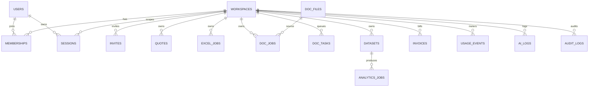

# FlowDesk 架构说明

本文记录 FlowDesk 的模块边界、数据模型、关键链路与扩展路径，适合在面试中解释“为什么这样设计”。

---

## 1. 系统上下文

```text
┌──────────────┐        HTTPS        ┌─────────────────────────────┐
│  Browser     │ ──────────────────▶ │  Nginx                      │
│  SPA / Print │                     │  TLS · gzip · static · 20MB │
└──────────────┘                     └──────────────┬──────────────┘
                                                    │ HTTP / keepalive
                                     ┌──────────────▼──────────────┐
                                     │  FastAPI（单进程）          │
                                     │                             │
                                     │  Router 层：HTTP / 校验     │
                                     │  Service 层：业务算法       │
                                     │  AI 层：云 / 本地 / 规则    │
                                     │  Worker：文档批量任务       │
                                     └───────┬─────────────┬───────┘
                                             │             │
                                  ┌──────────▼───┐  ┌──────▼────────┐
                                  │ SQLite WAL   │  │ data/uploads  │
                                  │ 业务 + 会话  │  │ 原始文档      │
                                  └──────────────┘  └───────────────┘
```

**部署约束**：单 uvicorn worker。Excel 上传会话在进程内；文档 worker 也运行在同一进程。这样换来最低内存占用和最简单的运维，代价是不能水平扩容，需要靠“任务快照 + 持久化”保证重启后的可恢复性。

---

## 2. 代码分层

| 层 | 目录 | 职责 | 不做什么 |
| --- | --- | --- | --- |
| 入口 | `app/main.py` | 生命周期、中间件、静态页、路由注册 | 不写业务逻辑 |
| 路由 | `app/routers/` | 参数校验、权限依赖、HTTP 状态码、审计调用 | 不直接操作 DataFrame 细节 |
| 服务 | `app/services/` | Excel 清洗、文档解析、报价计算、分析算法 | 不关心 HTTP |
| 平台 | `app/security.py`、`quota.py`、`audit.py` | 会话、RBAC、套餐、计量、审计 | 不感知具体业务模块 |
| AI | `app/ai.py` | 三通道降级、JSON 解析、provider 标注 | 不阻塞主流程 |
| 数据 | `app/database.py` | schema、连接、WAL、JSON 字段、通用查询 | 不写业务规则 |
| 任务 | `app/workers.py` | 文件去重、任务状态机、线程池 worker | 不处理 HTTP |

模块之间只通过函数调用和 `workspace_id` 关联，没有跨模块的隐藏全局状态。拆分微服务时，`routers/` 基本可以原样迁移为独立服务。

---

## 3. 数据模型



### 关键字段

- 所有业务表都有 `workspace_id`，查询层强制带租户条件。
- `memberships(user_id, workspace_id, role)` 是 RBAC 的唯一事实来源。
- `sessions` 保存 opaque token 的 SHA-256、当前 `workspace_id`、过期时间；登出/禁用后立即失效。
- `doc_files` 以 `(workspace_id, sha256)` 去重，原文存 BLOB；`doc_jobs` 保存抽取结果与来源文件。
- `doc_tasks` 保存队列状态、优先级、尝试次数、`cancel_requested`、结果 JSON，重启后可继续。
- `usage_events` 是计量流水，套餐限额由聚合查询 + 配额检查共同保证。
- `ai_logs` 记录模块、provider、耗时、是否成功，用于解释“这次 AI 走的是哪条通道”。

---

## 4. 认证与会话

```text
POST /api/auth/login
  → 校验邮箱/密码（PBKDF2-SHA256）
  → 生成 32 字节随机 token
  → DB 存 SHA-256(token) + 过期时间
  → Set-Cookie: fd_session=<token>; HttpOnly; SameSite=Lax
  → 后续请求查 sessions + memberships + workspaces
```

- 不使用 JWT：服务端可立即撤销；重启不掉登录。
- 同时支持 `Authorization: Bearer <token>`，方便脚本和后续开放 API。
- 登录失败按 IP + 邮箱限流；生产环境可再加 Nginx `limit_req`。
- 同源校验：写请求若带 `Origin`，必须与当前 Host 或 `ALLOWED_ORIGINS` 匹配。
- 角色依赖：`require_workspace_admin` 负责 owner/admin，`require_platform_admin` 负责平台后台。

---

## 5. 配额与计费

```text
请求进入
  → quota.check(workspace, plan, units, storage_add)
      ├─ 本月任务数 + units <= plan.runs
      ├─ 存储 + storage_add <= plan.storage_mb
      └─ 成员数 + 1 <= plan.members
  → 执行任务
  → quota.consume(...) 写 usage_events
  → 失败任务不重复计量（由调用点决定）
```

- Free / Pro / Team 的限额集中在 `quota.PLANS`，前端只读同一份定义。
- 计费是**沙箱闭环**：订阅 → 创建发票 → 更新 workspace.plan → 配额立即变化；取消回到 Free。
- 不伪装真实支付，避免面试时无法解释支付合规与对账。

---

## 6. 文档任务状态机

```text
                 claim
   pending ───────────────▶ processing ───────────────▶ done
      ▲                         │
      │ retry (attempts < max)  │ exception
      └─────────────────────────┤
                                ▼
                              failed

   pending / processing ── cancel_requested=1 ──▶ canceled
```

- `claim_next()` 使用 `BEGIN IMMEDIATE` 原子领取任务，避免多 worker 重复消费。
- 每条任务独立保存 `fields_json`、`content`、`priority`、`max_attempts`。
- 处理结果写 `doc_tasks.result_json`，同时生成 `doc_jobs` 供历史与导出使用。
- 失败保留错误信息，可人工重试；取消是协作式的，worker 在检查点退出。
- 2C2G 默认 `DOC_WORKERS=1`；增加 worker 前应先迁移到 PostgreSQL/独立队列。

---

## 7. AI 降级链路

```text
业务函数（excel_command / doc_fields / quote_items / sales_insight）
        │
        ▼
     ai.chat()
        ├─ api：OpenAI 兼容 /chat/completions
        ├─ ollama：/api/chat，自动选择已安装模型
        └─ rules：确定性规则
        │
        ▼
   返回 (结果, provider)
        │
        ├─ 前端显示 via_label
        ├─ ai_logs 记录 provider / latency
        └─ 失败时业务层使用规则结果，不抛 500
```

- 结构化任务使用 `format=json` / JSON mode，解析失败会尝试截取首个 JSON 对象。
- 云端 Key 不存在时不会请求云端；`AI_MODE=rules` 时完全不探测 Ollama。
- 规则引擎不是“假数据”，而是可解释的兜底：报价按需求拆项、文档按正则/字段规则抽取、洞察按 KPI 生成结论。

---

## 8. 关键失败模式

| 故障 | 表现 | 处理 |
| --- | --- | --- |
| 云 AI 超时 / 401 | 业务仍返回 200 | 降级 Ollama → 规则，标注 provider |
| Ollama 未启动 | 状态显示规则引擎 | 2 秒探测超时，不阻塞主流程 |
| 文档解析失败 | 单条任务 failed | 保留错误与尝试次数，可重试/取消 |
| worker 进程重启 | processing 任务残留 | 启动时由队列逻辑重新领取/重试（按尝试次数） |
| SQLite 写冲突 | 短暂 `database is locked` | WAL + 短事务 + 单进程；重试由调用层处理 |
| 配额耗尽 | 413 / 402 类业务错误 | 前端提示升级套餐，不产生半成品 |
| 上传超大文件 | 413 | Nginx 20MB + 应用 15MB 双重限制 |

---

## 9. 扩展路径

### 到 PostgreSQL

1. 替换 `database.py` 的连接与占位符；
2. 将 `TEXT` JSON 字段改为 `JSONB`；
3. 把 `doc_tasks` 的原子领取改为 `SELECT ... FOR UPDATE SKIP LOCKED`；
4. 增加 Alembic 迁移。

### 到独立 worker

1. Redis / SQS 作为队列；
2. worker 独立进程，Web 只入队；
3. 文件迁移到 S3/OSS；
4. Excel 会话迁移到 Redis 或对象存储。

### 到多实例

- 需要把内存中的 Excel 会话外置；
- 文档 worker 与 Web 分离；
- 会话表保留在共享数据库；
- Nginx 上游增加多实例与健康检查。

---

## 10. 2C2G 资源账

| 组件 | 估算 |
| --- | --- |
| Python + FastAPI + pandas | 180–320 MB |
| SQLite page cache / 连接 | 20–60 MB |
| 文档 worker（单线程） | 30–80 MB |
| Nginx | 20–40 MB |
| 系统与 Docker | 200–300 MB |
| **合计** | **约 500–800 MB**，留出 1GB+ 给突发与页缓存 |

因此 2C2G 的关键不是“能不能启动”，而是“不要同时跑多个重任务”。FlowDesk 通过单 worker、上传大小限制、2 万行分析上限和流式导出控制峰值。
